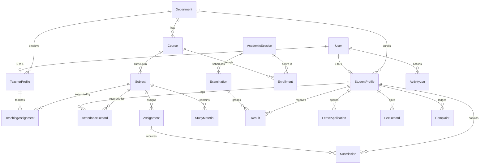

# ACADIFY – Complete Student Management Web Application
> **One Platform. Complete Academic Management.**


---

## 1. Executive Project Overview

**Acadify** is an enterprise-grade, server-side rendered Student Management Web Application developed with Django, Bootstrap 5, Vanilla JavaScript, and Chart.js.

The visual design is modeled on modern educational SaaS dashboards, featuring:
- A signature **Dark Navy Sidebar** (`#111c44`) with glowing navigation states.
- Clean **White Elevation Cards** with subtle soft shadows.
- Vibrant indigo accents (`#4318ff`), emerald success indicators (`#05cd99`), and warning amber tones.
- Three strictly partitioned user roles: **Admin**, **Teacher**, and **Student**.
- **100% Genuinely Database-Driven (Zero Fake Data Guarantee)**: All metrics, attendance rates, grade summaries, and chart data points are dynamically aggregated via Django ORM. When no records exist, the platform renders zero states with helpful onboarding prompts.

---

## 2. Supported Roles & Permission Architecture

| Role | Key Capabilities | Default Landing Route |
| :--- | :--- | :--- |
| **Admin** | Full system governance, faculty & student accounts, curriculum, timetable, reports, financial fees, settings. | `/admin-panel/dashboard/` |
| **Teacher** | Assigned subject timetable, daily attendance marking, assignment creation & grading, resource uploads, leave reviews. | `/teacher/dashboard/` |
| **Student** | Personal profile, attendance tracking, weekly schedule, assignment submission, exam results & CGPA, fees, grievances. | `/student/dashboard/` |

---

## 3. Technology Stack

- **Backend**: Python 3.13+, Django 6.1+ (Server-Side Rendering)
- **Database**: SQLite (Development) / PostgreSQL-ready relational architecture
- **Frontend**: HTML5, CSS3, Vanilla JavaScript, Bootstrap 5.3.3, Bootstrap Icons 1.11.3
- **Data Visualization**: Chart.js 4.4.2
- **File & Media Handling**: Pillow (with strict extension and size validators)
- **Configuration**: python-dotenv (`.env`)

---

## 4. Database Schema (Entity-Relationship Diagram)



---

## 5. Quick Installation & Setup Guide

### Step 1: Clone or Navigate to the Repository
```bash
cd "c:\Users\yuvra\OneDrive\Desktop\Ai projects\acadify"
```

### Step 2: Virtual Environment Setup
```bash
# Windows PowerShell
python -m venv venv
.\venv\Scripts\Activate.ps1

# Linux / macOS
python3 -m venv venv
source venv/bin/activate
```

### Step 3: Install Required Dependencies
```bash
python -m pip install --upgrade pip
python -m pip install -r requirements.txt
```

### Step 4: Environment Configuration
Copy the sample environment variables:
```bash
cp .env.example .env
```
*(Customize `SECRET_KEY`, `DEBUG`, and `ALLOWED_HOSTS` inside `.env` as required)*.

### Step 5: Run Database Migrations
```bash
python manage.py migrate
```

### Step 6: Create Administrative Superuser
```bash
python manage.py createsuperuser
```
Follow prompts to set username, email, and password.

### Step 7: (Optional) Seed Realistic Demonstration Data
> **IMPORTANT NOTE**: The application starts with a 100% clean, empty database.
> If you want to populate realistic demo faculty, students, attendance, and timetable records for demonstration:
```bash
python manage.py seed_data
```
*Pre-configured demo credentials generated by seed_data:*
- **Admin**: `admin` / `admin123`
- **Faculty**: `teacher_sharma` / `teacher123` (or `teacher_gupta`, `teacher_khan`)
- **Student**: `student_rahul` / `student123` (or `student_priya`, `student_aman`)

### Step 8: Start the Local Development Server
```bash
python manage.py runserver
```
Visit the portal in your browser: **`http://127.0.0.1:8000/`**

---

## 6. Running Automated Tests

Acadify includes a comprehensive automated test suite covering authentication, RBAC authorization, duplicate prevention, attendance calculation, student record isolation, and all URL routes.

Run the test suite with:
```bash
python manage.py test tests
```

Expected output:
```text
Creating test database for alias 'default'...
.................
----------------------------------------------------------------------
Ran 17 tests in 2.077s

OK
Destroying test database for alias 'default'...
```

---

## 7. Complete Module & Page Directory

### Public & Authentication
- `/login/` - Dual login with email or username, remember me, and role redirection.
- `/register/` - Student, Faculty, and Admin registration with role pills.
- `/password-reset/` - Public credential recovery assistance.
- `/password-change/` - Authenticated secure password change.
- `/logout/` - Secure session invalidation and activity logging.

### Admin Panel (`/admin-panel/`)
- `/dashboard/` - Dynamic KPIs, attendance overview chart, department donut chart, recent live activities, announcements.
- `/students/` - Student listing, search, department/course filters, ID generator, account toggle, detailed 360° record view.
- `/teachers/` - Faculty roster, department assignment, office room allocation.
- `/departments/` - Department codes, names, and Head of Department (HOD) appointments.
- `/courses/` - Degree programs, durations, and semester count.
- `/subjects/` - Course modules, credits, theory vs practical designations.
- `/enrollments/` - Student batch sessions, degree enrollment, and semester registrations.
- `/attendance/` - College-wide attendance audit logs and **one-click CSV export**.
- `/timetable/` - Weekly schedule manager with room collision detection.
- `/assignments/` - Campus-wide task monitoring.
- `/results/` - Examination creation, marks entry, and GPA computation.
- `/leaves/` - Absence requests review desk with approve/reject actions and remarks.
- `/notices/` - Announcement publisher targeting specific audiences and departments.
- `/fees/` - Invoice generator, collections ledger, and "Mark Paid" reconciliation.
- `/complaints/` - Grievance resolution desk and response management.
- `/reports/` - Institutional summaries, attendance distributions, financial totals.
- `/settings/` - Academic sessions manager, active term switch, platform diagnostics.

### Teacher Portal (`/teacher/`)
- `/dashboard/` - Assigned classes, student headcount, pending submissions, today's schedule.
- `/profile/` - Faculty profile details, qualifications, and office room.
- `/classes/` - Weekly assigned schedule.
- `/students/` - Enrolled students roster for assigned subjects.
- `/attendance/` - Real-time daily attendance grid (Present, Absent, Late, Leave) with bulk "Mark All Present".
- `/assignments/` - Assignment builder with due dates and attachments.
- `/submissions/` - Submission inbox for reviewing and grading student work.
- `/study-materials/` - Upload PDFs, slides, and syllabus documents organized by subject.
- `/results/` - Continuous internal and end-semester marks entry with automatic grade calculation.
- `/leaves/` - Review and approve student absence requests.
- `/notices/` - Class-level announcements.

### Student Portal (`/student/`)
- `/dashboard/` - Personal attendance rate, upcoming class alerts, pending homework count, CGPA, fee status.
- `/profile/` - Student ID card, personal info, guardian contacts, academic placement.
- `/attendance/` - Attendance history, subject-wise percentage bars, and present/absent stats.
- `/timetable/` - Weekly lecture timetable with rooms and instructor details.
- `/assignments/` - Task deadlines, file downloads, and online homework submission.
- `/results/` - Semester-by-semester grade sheets, internal/external split, SGPA/CGPA, and total percentage.
- `/leave/` - Absence application submission and approval status tracker.
- `/notices/` - Campus circulars and departmental notifications.
- `/study-materials/` - Course resource repository and download manager.
- `/fees/` - Semester fee invoices, payment receipts, and balance status.
- `/complaints/` - Student grievance ticket submission and administrative reply tracker.

---

## 8. Security & Engineering Standards

- **Cross-Site Request Forgery (CSRF)**: All POST/PUT/DELETE forms include cryptographically verified `` tokens.
- **Role-Based Authorization (RBAC)**: Enforced via custom view decorators (`@admin_required`, `@teacher_required`, `@student_required`) and queryset filtering.
- **Database Isolation**: Students cannot access private records, attendances, or complaints belonging to other students.
- **File Upload Security**: File type validation restricts executable uploads, allowing only verified document formats (PDF, DOCX, ZIP, JPG, PNG).
- **Relational Integrity**: Database constraints prevent duplicate attendances, conflicting timetable slots, and duplicate student IDs.
- **Zero Fake Data**: The application contains no mock static arrays; all statistics are dynamically aggregated from database records.

---

## 9. License

This project is licensed under the MIT License. Developed for academic excellence with Acadify.
